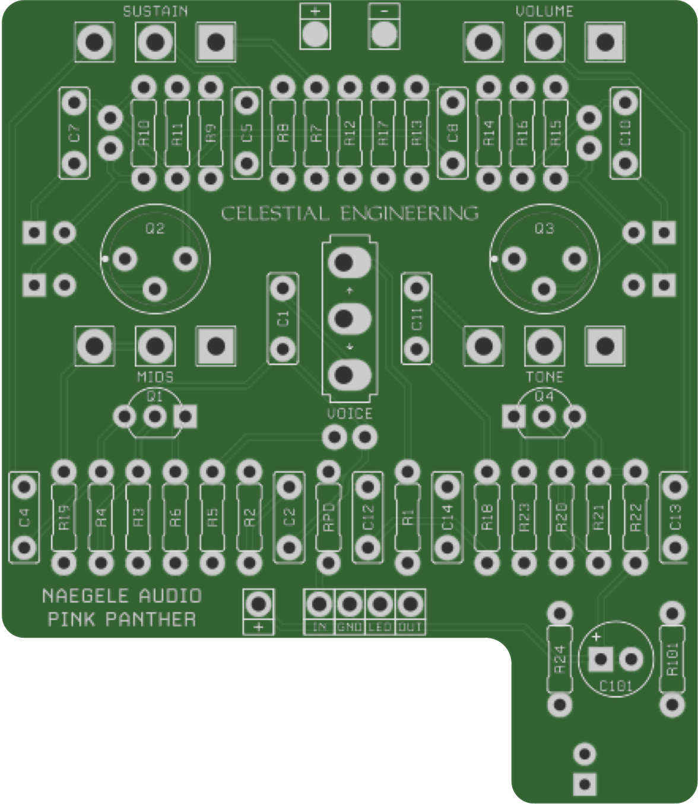
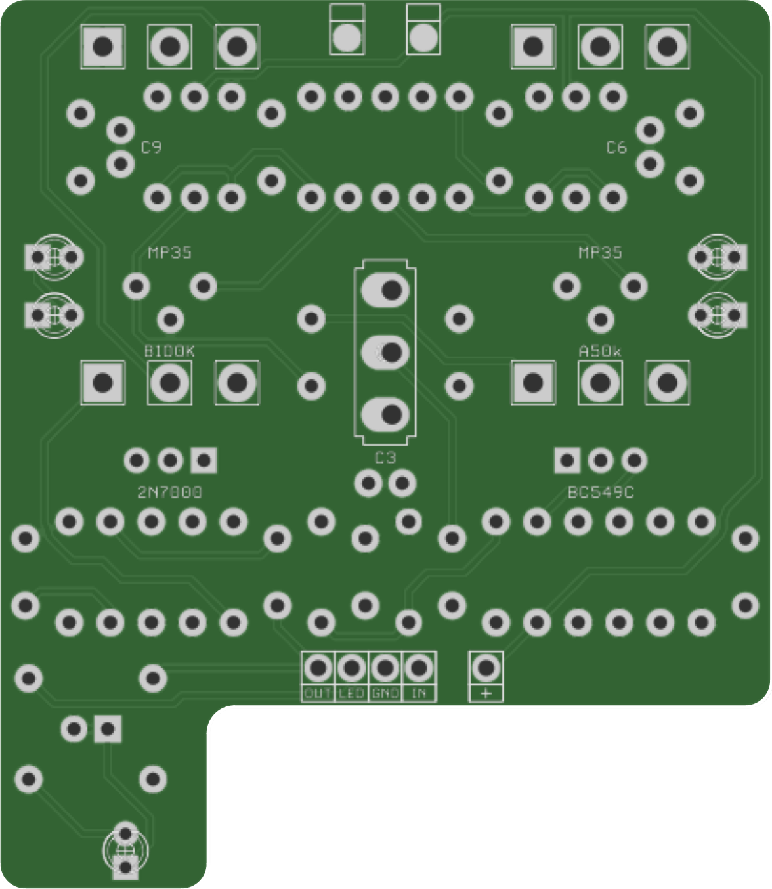

# Boneyard Hoof
### Hosted board

Chuck D. Bones' reworked EarthQuaker Devices Hoof, a germanium Big Muff. Circuit by [Chuck D. Bones](https://forum.pedalpcb.com/threads/the-week-on-the-breadboard-eqd-hoof-boneyard-mod.21830/), PCB by Naegele Audio ([PedalBuilder](https://forum.pedalpcb.com/members/pedalbuilder.487/) on the PedalPCB forum).

**PCB, BOM, build notes and a link to Chuck's thread are on the wiki: [Boneyard Hoof](https://github.com/drlholloway/guitar-effects-layouts/wiki/Boneyard-Hoof)**

| Front | Back |
|-------|------|
|  |  |

## Files

| File | Description |
|------|-------------|
| [Boneyard-Hoof-PedalBuilder-GERBER.zip](Boneyard-Hoof-PedalBuilder-GERBER.zip) | PCB gerbers |
| [boneyard-hoof-pcb-front.png](boneyard-hoof-pcb-front.png) | PCB front, rendered from the gerbers |
| [boneyard-hoof-pcb-back.png](boneyard-hoof-pcb-back.png) | PCB back, rendered from the gerbers |

## Credits

Hosted here with Naegele Audio's permission. This board is not covered by the repository's Creative Commons license.

Naegele Audio also sells PCBs for other circuits, plus relay bypass and I/O boards: [message PedalBuilder on the PedalPCB forum](https://forum.pedalpcb.com/members/pedalbuilder.487/).
