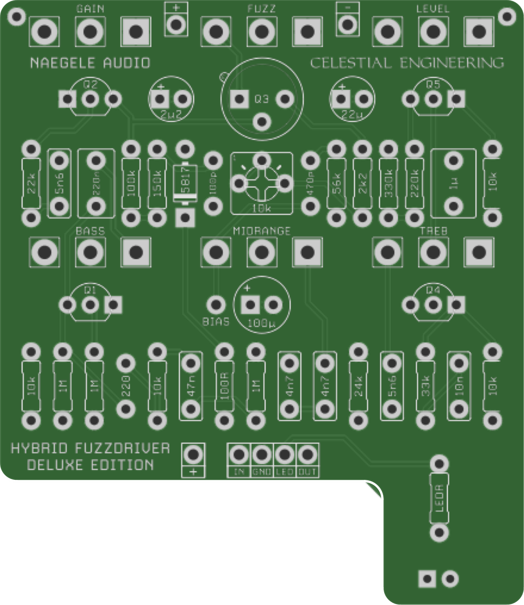
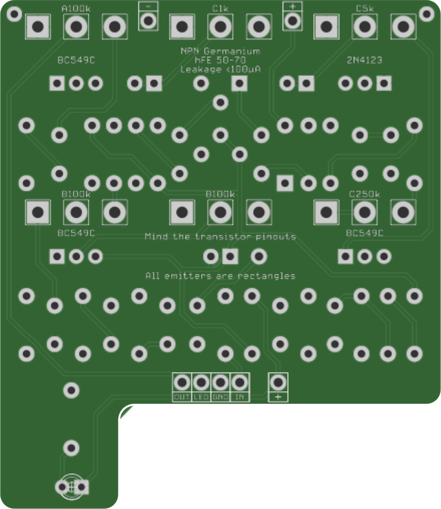

# Hybrid Fuzz Driver Deluxe
### Hosted board

Chuck D. Bones' six-knob take on the Skreddy Hybrid Fuzz Driver. Circuit by [Chuck D. Bones](https://forum.pedalpcb.com/threads/this-week-on-the-breadboard-the-hybrid-fuzz-driver-deluxe.25456/), PCB by [PedalBuilder](https://forum.pedalpcb.com/members/pedalbuilder.487/) (Naegele Audio).

**PCB, BOM, build notes and a link to Chuck's thread are on the wiki: [Hybrid Fuzz Driver Deluxe](https://github.com/drlholloway/guitar-effects-layouts/wiki/Hybrid-Fuzz-Driver-Deluxe)**

| Front | Back |
|-------|------|
|  |  |

## Files

| File | Description |
|------|-------------|
| [Gerber_Boneyard-Hybrid-Fuzz-Driver_PCB_Boneyard-Hybrid-Fuzz-Driver_2025-03-26.zip](Gerber_Boneyard-Hybrid-Fuzz-Driver_PCB_Boneyard-Hybrid-Fuzz-Driver_2025-03-26.zip) | PCB gerbers |
| [hybrid-fuzz-driver-deluxe-pcb-front.png](hybrid-fuzz-driver-deluxe-pcb-front.png) | PCB front, rendered from the gerbers |
| [hybrid-fuzz-driver-deluxe-pcb-back.png](hybrid-fuzz-driver-deluxe-pcb-back.png) | PCB back, rendered from the gerbers |

## Credits

Hosted here with PedalBuilder's permission. This board is not covered by the repository's Creative Commons license.
