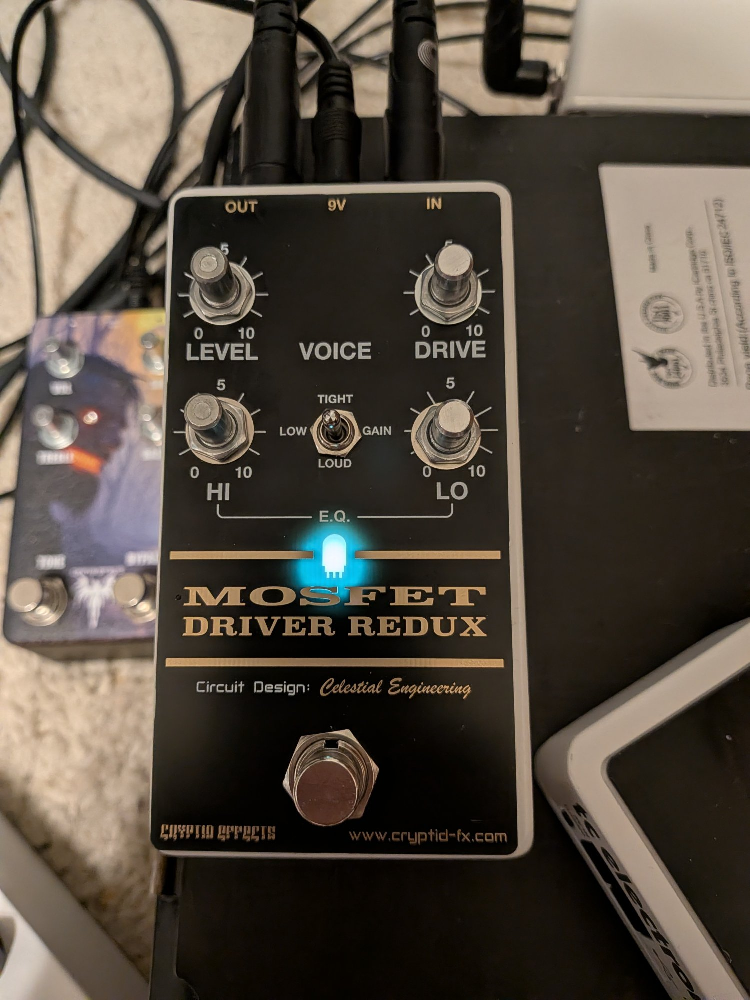
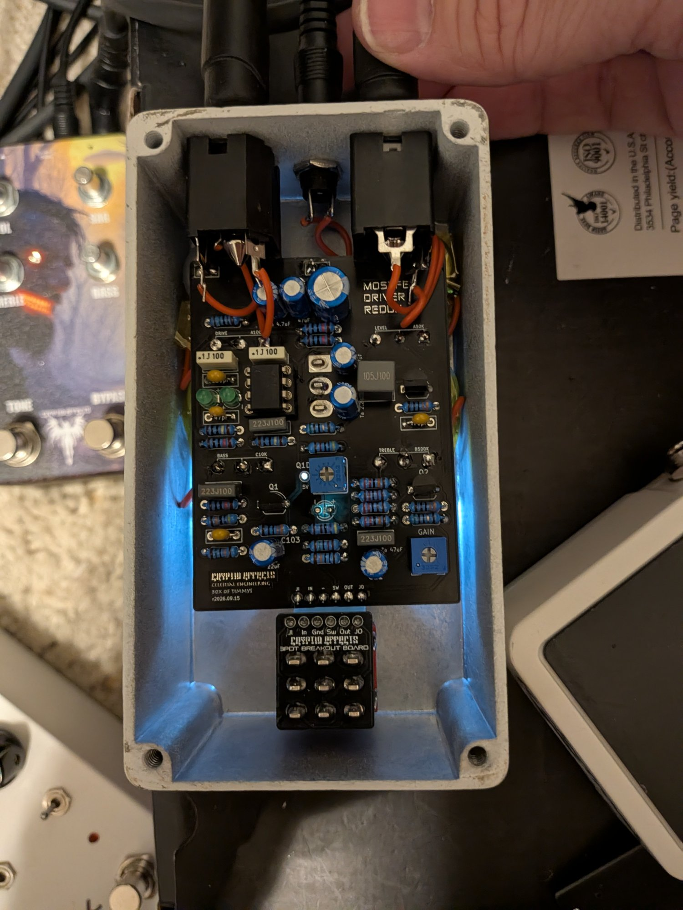

# MOSFET Driver Redux
### Verified

A PCB and faceplate for Chuck D. Bones' [MOSFET Driver Redux](https://forum.pedalpcb.com/threads/this-week-on-the-breadboard-mosfet-driver-redux.8761/) (Box of Timmys): a Timmy style op-amp stage into two BS170 MOSFET gain stages, with a Tube Driver styled faceplate. 125B enclosure.

**Schematic, PCB, faceplate, BOM, and build notes are on the wiki: [MOSFET Driver Redux](https://github.com/drlholloway/guitar-effects-layouts/wiki/MOSFET-Driver-Redux)**

| Front | Guts |
|-------|------|
|  |  |

## Files

| File | Description |
|------|-------------|
| [MosfetDriverRedux_r2026-10-15-GERBER.zip](MosfetDriverRedux_r2026-10-15-GERBER.zip) | PCB gerbers |
| [MosfetDriverRedux-Faceplate-r2026-10-15-GERBER.zip](MosfetDriverRedux-Faceplate-r2026-10-15-GERBER.zip) | Faceplate gerbers |
| [mosfet-driver-redux-schematic.svg](mosfet-driver-redux-schematic.svg) | Schematic |
| [mosfet-driver-redux-pcb-front-2026-10-15.png](mosfet-driver-redux-pcb-front-2026-10-15.png) | PCB front traces |
| [mosfet-driver-redux-pcb-back-2026-10-15.png](mosfet-driver-redux-pcb-back-2026-10-15.png) | PCB back traces |
| [mosfet-driver-redux-faceplate-2026-10-15.png](mosfet-driver-redux-faceplate-2026-10-15.png) | Faceplate |
| [mosfet-driver-redux-complete.jpg](mosfet-driver-redux-complete.jpg) | Completed pedal |
| [mosfet-driver-redux-guts.jpg](mosfet-driver-redux-guts.jpg) | Guts |

## Licensing

This layout is licensed with a Creative Commons BY-NC-SA 4.0 license (Attribution, Non-commercial, Share-alike). The MOSFET Driver Redux circuit was designed by Chuck D. Bones.
