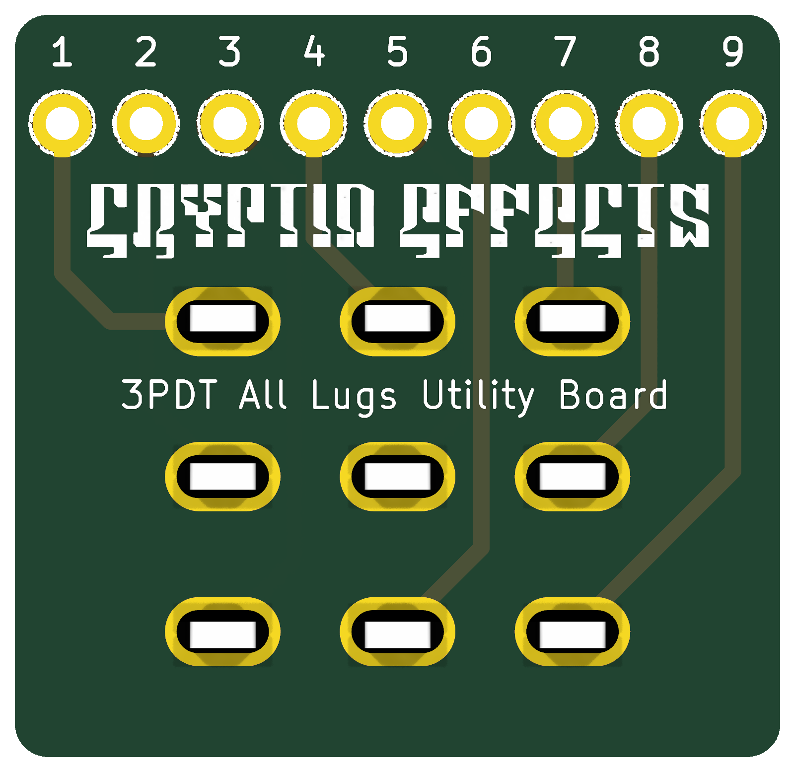

# 3PDT All Lugs
### Verified

A 3PDT footswitch board that brings all nine lugs out to a numbered row of pads, for any wiring you like.

**Schematic, PCB, BOM, and build notes are on the wiki: [3PDT All Lugs](https://github.com/drlholloway/guitar-effects-layouts/wiki/3PDT-All-Lugs)**

## Files

| File | Description |
|------|-------------|
| [GERBER-3PDT-All-Lugs-r2026-09-13.zip](GERBER-3PDT-All-Lugs-r2026-09-13.zip) | PCB gerbers |
| [3pdt-all-lugs-schematic.svg](3pdt-all-lugs-schematic.svg) | Schematic |
| [3pdt-all-lugs-pcb-front.png](3pdt-all-lugs-pcb-front.png) | PCB front |
| [3pdt-all-lugs-pcb-back.png](3pdt-all-lugs-pcb-back.png) | PCB back |
