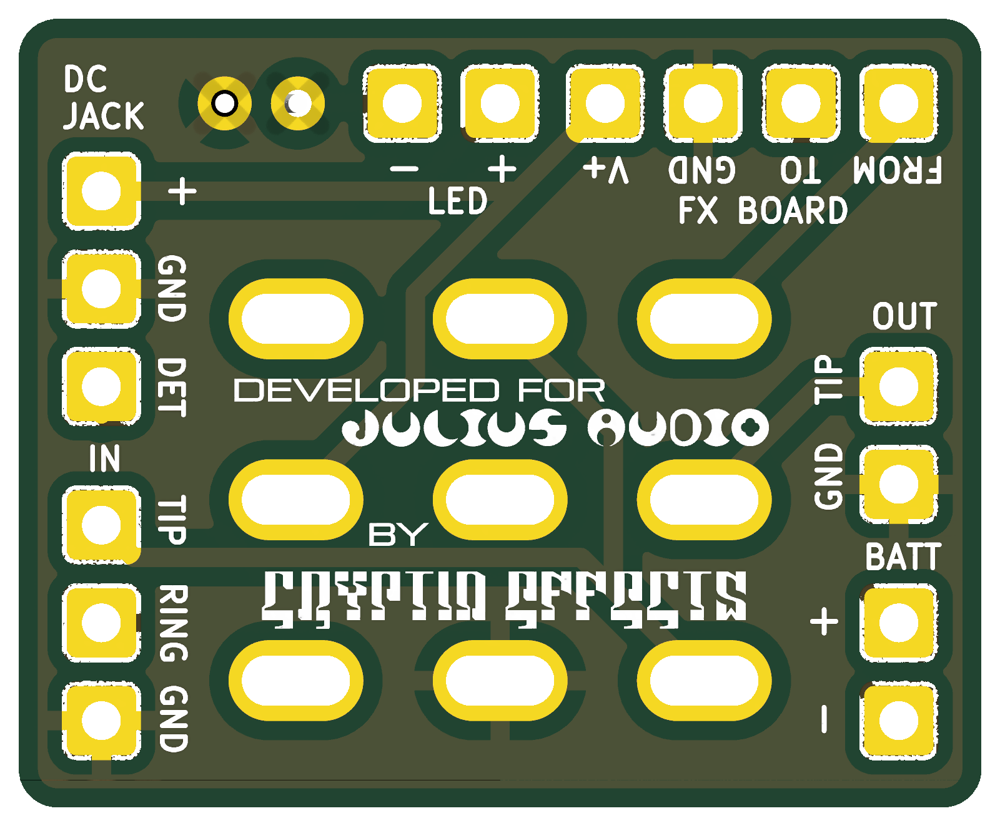

# 3PDT Kitchen Sink Board
### Verified

A 3PDT footswitch board with pads for everything: DC jack, input and output jacks, battery, LED (with its resistor) and the effect board.

**Schematic, PCB, BOM, and build notes are on the wiki: [3PDT Kitchen Sink Board](https://github.com/drlholloway/guitar-effects-layouts/wiki/3PDT-Kitchen-Sink-Board)**

## Files

| File | Description |
|------|-------------|
| [GERBER-3PDT-Kitchen-Sink-Board-r2026-04-25.zip](GERBER-3PDT-Kitchen-Sink-Board-r2026-04-25.zip) | PCB gerbers |
| [3pdt-kitchen-sink-board-schematic.svg](3pdt-kitchen-sink-board-schematic.svg) | Schematic |
| [3pdt-kitchen-sink-board-pcb-front.png](3pdt-kitchen-sink-board-pcb-front.png) | PCB front |
| [3pdt-kitchen-sink-board-pcb-back.png](3pdt-kitchen-sink-board-pcb-back.png) | PCB back |
