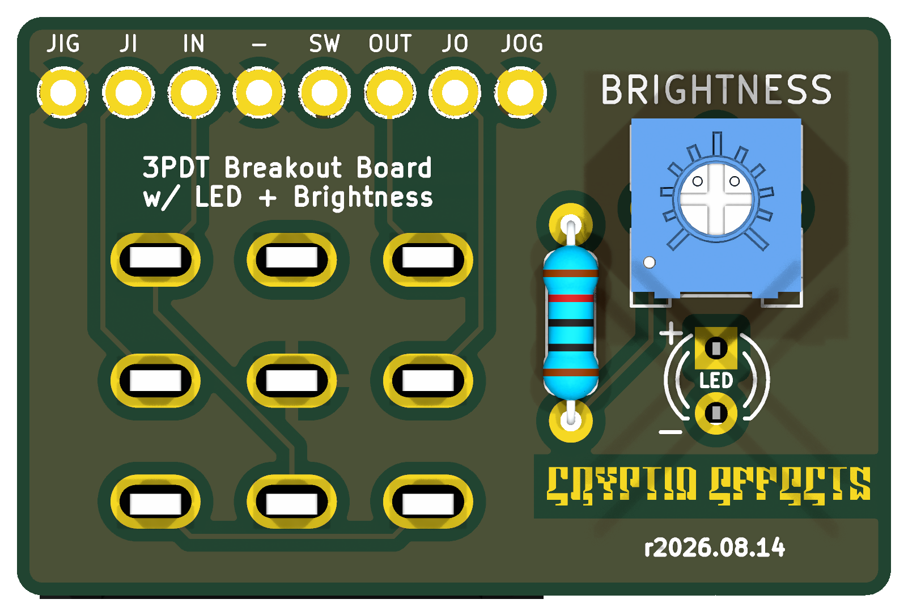

# 3PDT LED Board
### Verified

A 3PDT footswitch board with the status LED, its resistor and a brightness trimmer on the board.

**Schematic, PCB, BOM, and build notes are on the wiki: [3PDT LED Board](https://github.com/drlholloway/guitar-effects-layouts/wiki/3PDT-LED-Board)**

## Files

| File | Description |
|------|-------------|
| [GERBER-3PDT-LED-Board-r2026-08-14.zip](GERBER-3PDT-LED-Board-r2026-08-14.zip) | PCB gerbers |
| [3pdt-led-board-schematic.svg](3pdt-led-board-schematic.svg) | Schematic |
| [3pdt-led-board-pcb-front.png](3pdt-led-board-pcb-front.png) | PCB front |
| [3pdt-led-board-pcb-back.png](3pdt-led-board-pcb-back.png) | PCB back |
