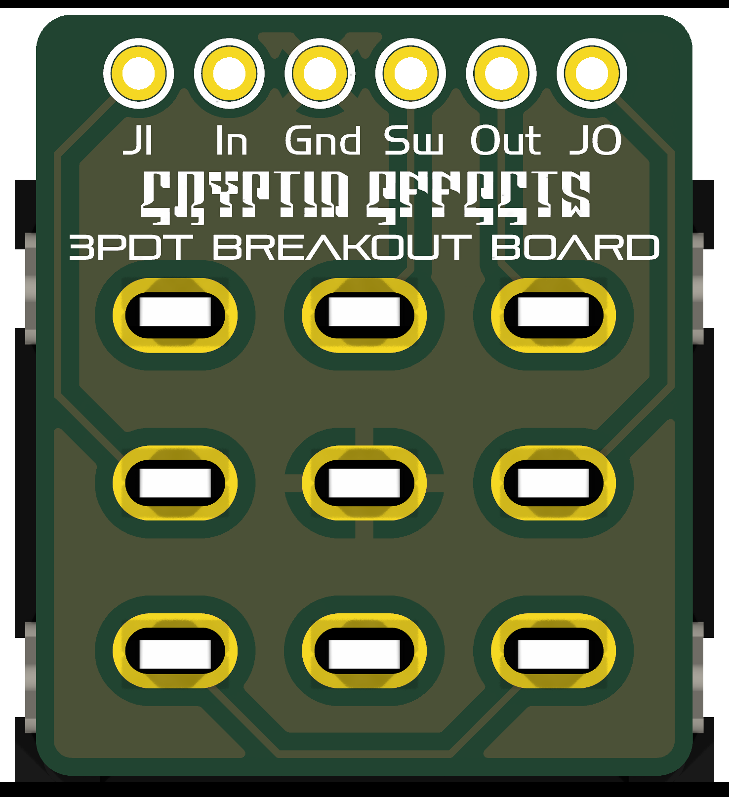

# 3PDT Utility Board
### Verified

A small true bypass 3PDT footswitch board with JI / In / Gnd / Sw / Out / JO pads.

**Schematic, PCB, BOM, and build notes are on the wiki: [3PDT Utility Board](https://github.com/drlholloway/guitar-effects-layouts/wiki/3PDT-Utility-Board)**

## Files

| File | Description |
|------|-------------|
| [GERBER-3PDT-Utility-Board-r2026-01-02.zip](GERBER-3PDT-Utility-Board-r2026-01-02.zip) | PCB gerbers |
| [3pdt-utility-board-schematic.svg](3pdt-utility-board-schematic.svg) | Schematic |
| [3pdt-utility-board-pcb-front.png](3pdt-utility-board-pcb-front.png) | PCB front |
| [3pdt-utility-board-pcb-back.png](3pdt-utility-board-pcb-back.png) | PCB back |
