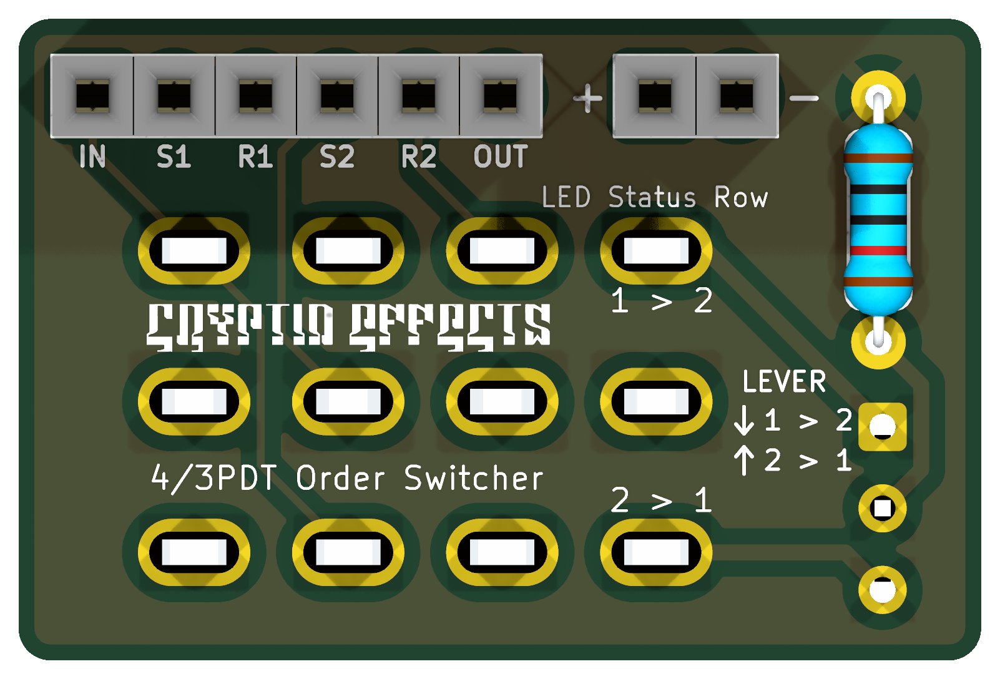

# 4PDT Order Switcher
### Not Verified, all this can change

> [!NOTE]
> This board hasn't been built yet, but its order switching and LED wiring are the same as in my Twosome build, which I have built and verified.

A toggle switch board that swaps the order of two effects (S1 then S2, or S2 then S1), with a bicolor LED that shows which order is selected.

**Schematic, PCB, BOM, and build notes are on the wiki: [4PDT Order Switcher](https://github.com/drlholloway/guitar-effects-layouts/wiki/4PDT-Order-Switcher)**

## Files

| File | Description |
|------|-------------|
| [GERBER-4PDT-Order-Switcher-r2026-10-16.zip](GERBER-4PDT-Order-Switcher-r2026-10-16.zip) | PCB gerbers |
| [4pdt-order-switcher-schematic.svg](4pdt-order-switcher-schematic.svg) | Schematic |
| [4pdt-order-switcher-pcb-front.png](4pdt-order-switcher-pcb-front.png) | PCB front |
| [4pdt-order-switcher-pcb-back.png](4pdt-order-switcher-pcb-back.png) | PCB back |
